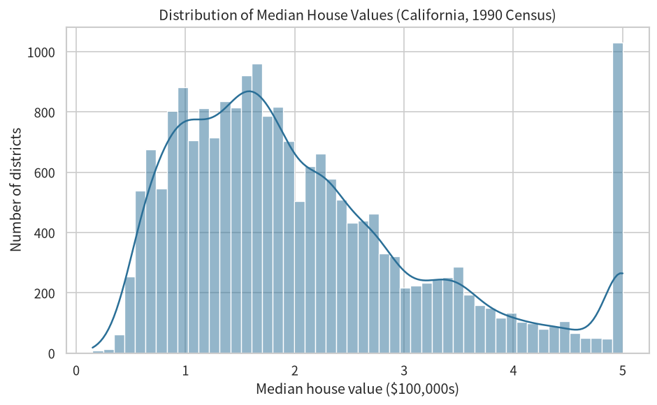
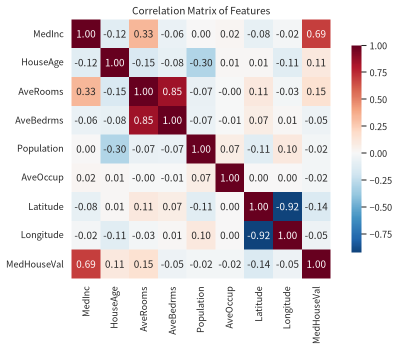
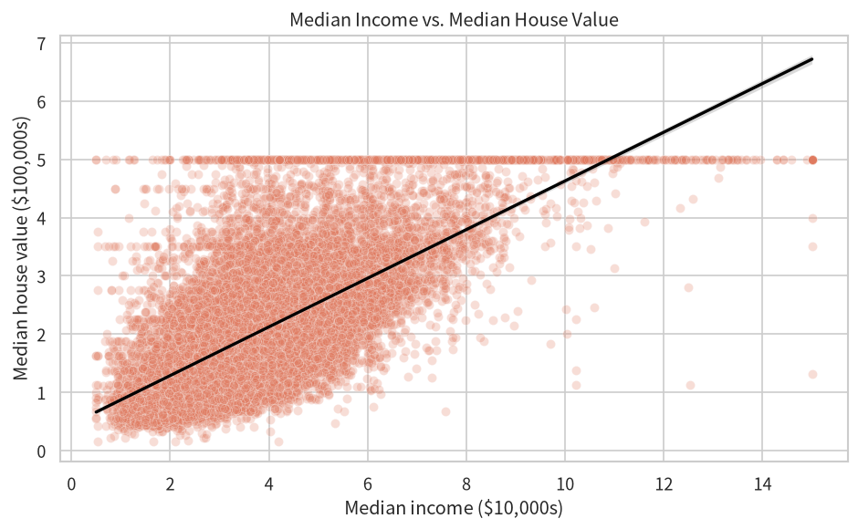
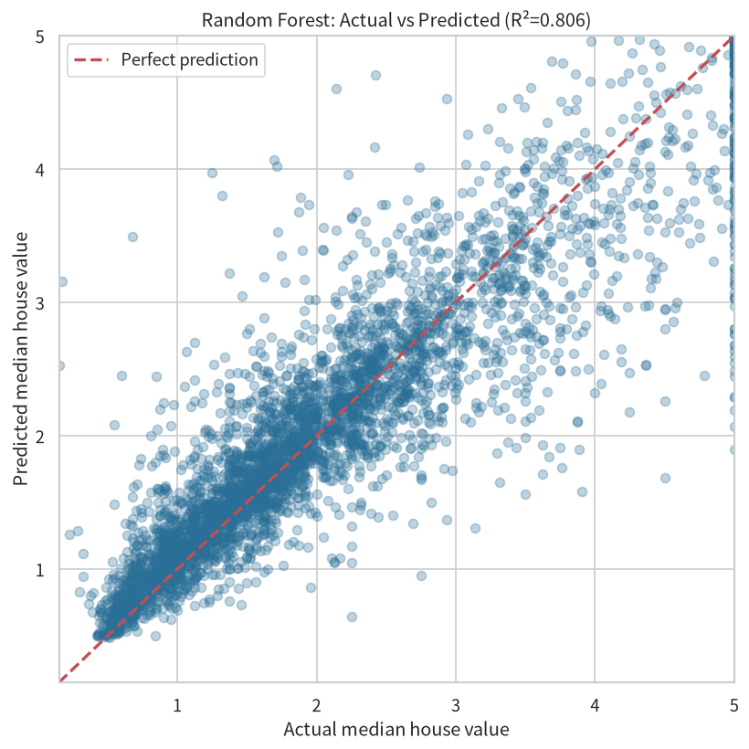
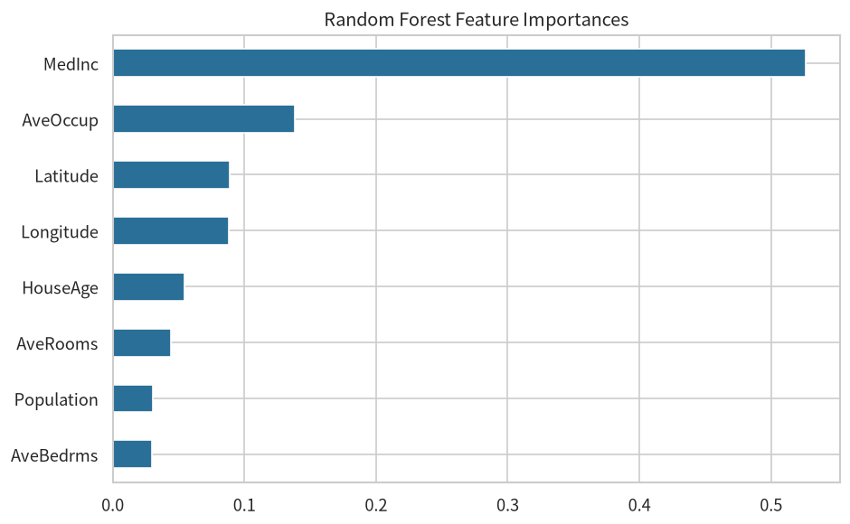

# California Housing Price Prediction

A complete, reproducible data science project that explores and models median
house prices across California districts using the **California Housing
Dataset**.

## 1. Problem / Research Question

Can we build a model that predicts the **median house value** of a California
district from features such as median income, house age, average number of
rooms, and population density? Which features are the strongest drivers of
house prices?

This is a classic **regression** task: given 8 features describing a district,
predict its median house value.

## 2. Dataset Source and Usage Permissions

- **Source:** `sklearn.datasets.fetch_california_housing` (the California Housing
  dataset, originally derived from the 1990 U.S. Census).
- **Size:** 20,640 rows x 9 columns, no missing values.
- **License / permissions:** Distributed under the **BSD-3-Clause** license and
  bundled with scikit-learn. It is a public dataset, freely usable for
  educational and research purposes. **No personal data or restricted data is
  contained in or uploaded to this repository.**

## 3. Methods and Tools

| Step | Method / Tool |
|------|---------------|
| Language & libraries | Python 3, pandas, NumPy, matplotlib, seaborn, scikit-learn |
| EDA | Distribution plots, correlation heatmap, scatter plots |
| Pre-processing | Feature set used as-is (already numeric, no missing values) |
| Modelling | Linear Regression and Random Forest Regressor |
| Evaluation | Train/test split (80/20), RMSE, R², feature importance |

## 4. Key Findings and One Limitation

### Key findings
- **Median income is by far the strongest predictor** of house price
  (correlation ≈ 0.69; top feature in Random Forest importance).
- House values are **right-skewed** — most districts are relatively affordable,
  with a long tail of high-value districts.
- **Random Forest clearly outperforms Linear Regression**
  (test R² = **0.806** vs **0.576**; RMSE **0.504** vs **0.746**), indicating
  the relationship between features and price is non-linear.

### One limitation
- The dataset comes from the **1990 census**, so the relationships learned may
  not reflect today's housing market; it also lacks contextual features such as
  schools, crime, or neighbourhood amenities that matter for prices.

## 5. Instructions for Running the Analysis

```bash
# 1. Clone the repository
git clone https://github.com/christal018/data-science-project.git
cd data-science-project

# 2. (Recommended) create a virtual environment
python -m venv venv
source venv/bin/activate        # Windows: venv\Scripts\activate

# 3. Install dependencies
pip install -r requirements.txt

# 4. Run the analysis script (generates all figures + prints model results)
python california_housing_analysis.py

# 5. (Optional) open the interactive notebook
jupyter notebook california_housing_analysis.ipynb
```

All figures are saved to `visualizations/`. The whole analysis is reproducible
from the script alone.

## Visualizations







---
*Project status: completed. Built as part of the CISC7204 Data Science
Portfolio learning activity.*
